# Esquema de la base de datos · Multi-Administrador

`db/init.sql` crea **31 tablas** conectadas por **65 llaves foráneas**, organizadas por módulo. Es idempotente: se puede ejecutar de nuevo sobre una base existente y la actualiza sin borrar datos.

## Diagrama general

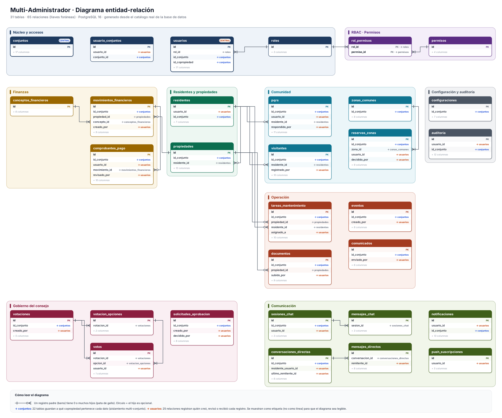

> Versión vectorial (zoom sin pérdida): [`diagrama_er.svg`](diagrama_er.svg). Las relaciones hacia `conjuntos` y `usuarios` se muestran como etiquetas dentro de cada tabla (no como líneas) porque, si no, casi todas las tablas quedarían unidas a esos dos puntos y el diagrama sería ilegible.

**Cómo leerlo:** la barra `|` está en el lado del registro padre (uno) y la pata de gallo `>` en el lado hijo (muchos). Un círculo `o` junto a la pata de gallo indica que la referencia es opcional.

**Verlo en DBeaver:** en el Navegador de bases de datos, clic derecho sobre el esquema `public` → *Ver diagrama*. Este archivo sirve de referencia para ordenar las tablas por módulo.

## Mapa de tablas

| Módulo | Tablas |
|---|---|
| Núcleo y accesos | `conjuntos`, `roles`, `usuarios`, `usuario_conjuntos` |
| RBAC | `permisos`, `rol_permisos` |
| Residentes y propiedades | `residentes`, `propiedades` |
| Finanzas | `conceptos_financieros`, `movimientos_financieros`, `comprobantes_pago` |
| Operación | `tareas_mantenimiento`, `documentos`, `eventos`, `comunicados` |
| Comunidad | `pqrs`, `zonas_comunes`, `reservas_zonas`, `visitantes` |
| Gobierno del consejo | `votaciones`, `votacion_opciones`, `votos`, `solicitudes_aprobacion` |
| Comunicación | `sesiones_chat`, `mensajes_chat`, `conversaciones_directas`, `mensajes_directos`, `notificaciones`, `push_suscripciones` |
| Configuración | `configuraciones` |
| Auditoría | `auditoria` |

## Ejes del modelo

- **`conjuntos`** → 22 relaciones. Todas las tablas operativas llevan `id_conjunto` para aislar los datos de cada copropiedad (multi-conjunto).
- **`usuarios`** → 25 relaciones. Registran quién creó, revisó, aprobó, asignó o recibió cada registro (`creado_por`, `revisado_por`, `usuario_id`, ...).
- **`propiedades`** y **`residentes`** son el centro del negocio: de ellas cuelgan finanzas, mantenimiento, documentos, PQRS y visitantes.

## Relaciones por módulo

Cada módulo muestra todas las llaves foráneas de sus tablas, incluidas las que apuntan a tablas de otros módulos (tablas sin atributos extra = pertenecen a otro módulo). ★ marca las relaciones añadidas en esta revisión.

### Núcleo y accesos

Raíz del modelo. `conjuntos` (copropiedades) y `usuarios` son los dos ejes a los que casi todo se conecta.

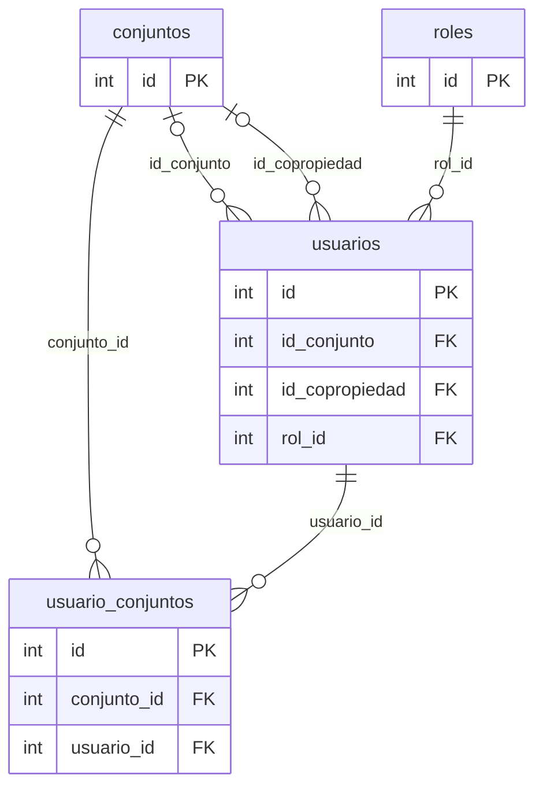

| Tabla.columna | Apunta a | ¿Obligatoria? | Si se borra el registro padre |
|---|---|---|---|
| `usuarios.id_conjunto` | `conjuntos.id` | No | Deja la referencia vacía (`SET NULL`) |
| `usuarios.id_copropiedad` ★ | `conjuntos.id` | No | Deja la referencia vacía (`SET NULL`) |
| `usuarios.rol_id` | `roles.id` | Sí | Impide el borrado (`NO ACTION`) |
| `usuario_conjuntos.conjunto_id` | `conjuntos.id` | Sí | Borra también el registro (`CASCADE`) |
| `usuario_conjuntos.usuario_id` | `usuarios.id` | Sí | Borra también el registro (`CASCADE`) |

### RBAC

Control de acceso por rol: qué permiso tiene cada rol (relación N:M).

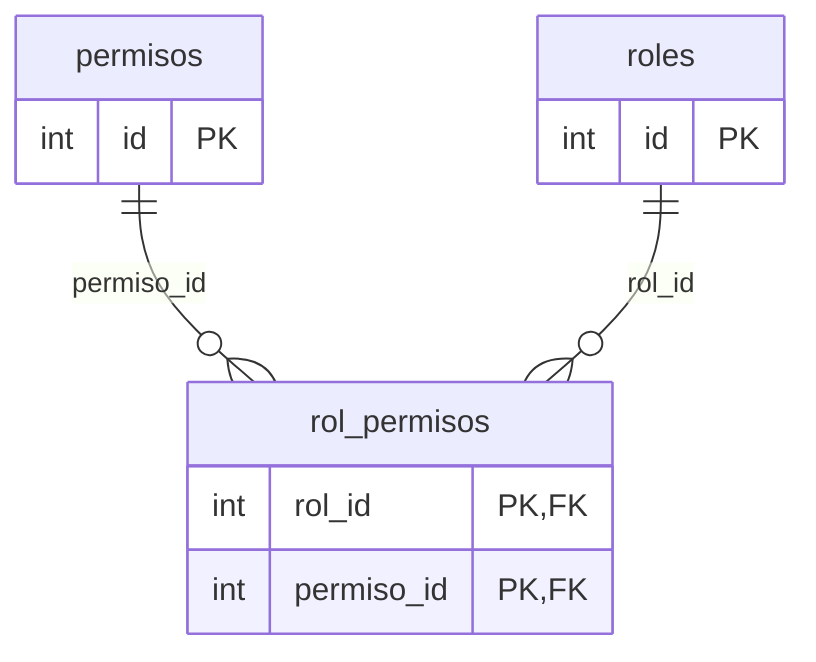

| Tabla.columna | Apunta a | ¿Obligatoria? | Si se borra el registro padre |
|---|---|---|---|
| `rol_permisos.permiso_id` | `permisos.id` | Sí | Borra también el registro (`CASCADE`) |
| `rol_permisos.rol_id` | `roles.id` | Sí | Borra también el registro (`CASCADE`) |

### Residentes y propiedades

Quién vive en cada unidad. `propiedades` es la base de finanzas, mantenimiento y documentos.

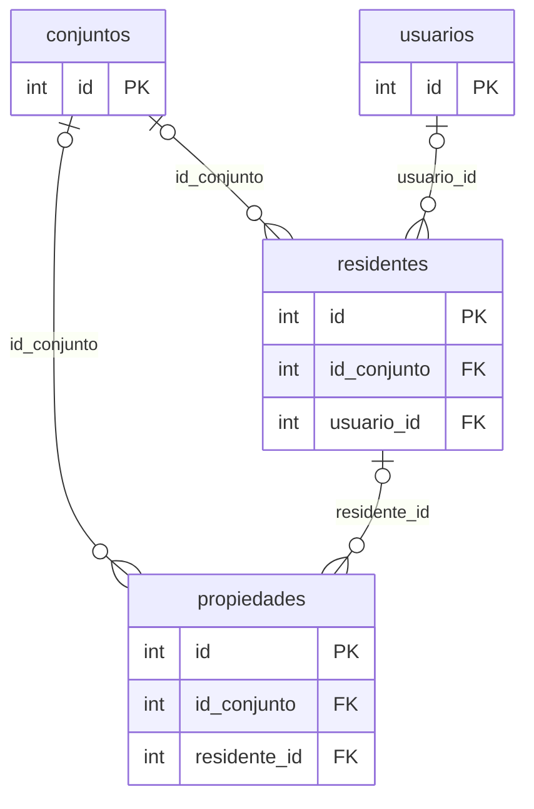

| Tabla.columna | Apunta a | ¿Obligatoria? | Si se borra el registro padre |
|---|---|---|---|
| `residentes.id_conjunto` | `conjuntos.id` | No | Deja la referencia vacía (`SET NULL`) |
| `residentes.usuario_id` | `usuarios.id` | No | Deja la referencia vacía (`SET NULL`) |
| `propiedades.id_conjunto` | `conjuntos.id` | No | Deja la referencia vacía (`SET NULL`) |
| `propiedades.residente_id` | `residentes.id` | No | Deja la referencia vacía (`SET NULL`) |

### Finanzas

Cobros y gastos por propiedad, y los comprobantes de pago que se revisan.

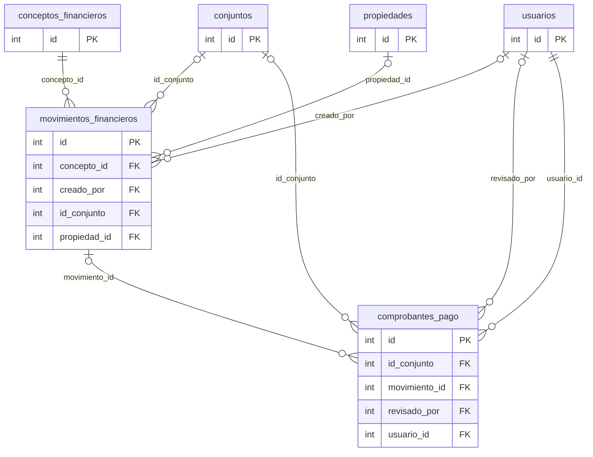

| Tabla.columna | Apunta a | ¿Obligatoria? | Si se borra el registro padre |
|---|---|---|---|
| `movimientos_financieros.concepto_id` | `conceptos_financieros.id` | Sí | Impide el borrado (`NO ACTION`) |
| `movimientos_financieros.creado_por` | `usuarios.id` | No | Deja la referencia vacía (`SET NULL`) |
| `movimientos_financieros.id_conjunto` | `conjuntos.id` | No | Deja la referencia vacía (`SET NULL`) |
| `movimientos_financieros.propiedad_id` | `propiedades.id` | No | Deja la referencia vacía (`SET NULL`) |
| `comprobantes_pago.id_conjunto` | `conjuntos.id` | No | Deja la referencia vacía (`SET NULL`) |
| `comprobantes_pago.movimiento_id` | `movimientos_financieros.id` | No | Deja la referencia vacía (`SET NULL`) |
| `comprobantes_pago.revisado_por` | `usuarios.id` | No | Deja la referencia vacía (`SET NULL`) |
| `comprobantes_pago.usuario_id` | `usuarios.id` | Sí | Borra también el registro (`CASCADE`) |

### Operación

Gestión diaria de la copropiedad.

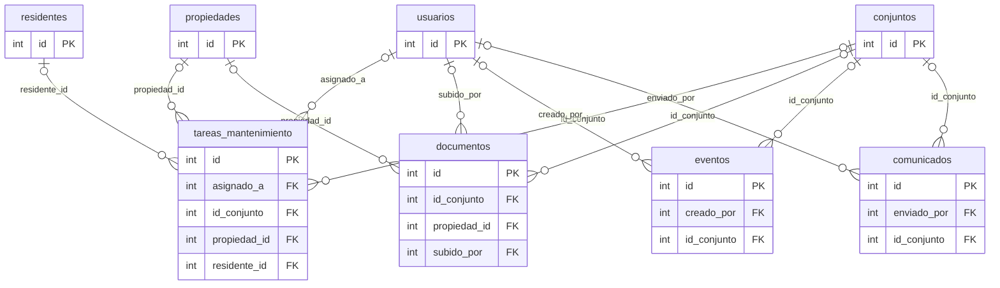

| Tabla.columna | Apunta a | ¿Obligatoria? | Si se borra el registro padre |
|---|---|---|---|
| `tareas_mantenimiento.asignado_a` | `usuarios.id` | No | Deja la referencia vacía (`SET NULL`) |
| `tareas_mantenimiento.id_conjunto` | `conjuntos.id` | No | Deja la referencia vacía (`SET NULL`) |
| `tareas_mantenimiento.propiedad_id` | `propiedades.id` | No | Deja la referencia vacía (`SET NULL`) |
| `tareas_mantenimiento.residente_id` | `residentes.id` | No | Deja la referencia vacía (`SET NULL`) |
| `documentos.id_conjunto` | `conjuntos.id` | No | Deja la referencia vacía (`SET NULL`) |
| `documentos.propiedad_id` | `propiedades.id` | No | Deja la referencia vacía (`SET NULL`) |
| `documentos.subido_por` | `usuarios.id` | No | Deja la referencia vacía (`SET NULL`) |
| `eventos.creado_por` | `usuarios.id` | No | Deja la referencia vacía (`SET NULL`) |
| `eventos.id_conjunto` | `conjuntos.id` | No | Deja la referencia vacía (`SET NULL`) |
| `comunicados.enviado_por` | `usuarios.id` | No | Deja la referencia vacía (`SET NULL`) |
| `comunicados.id_conjunto` | `conjuntos.id` | No | Deja la referencia vacía (`SET NULL`) |

### Comunidad

Servicios al residente: PQRS, reservas de zonas comunes y control de visitantes.

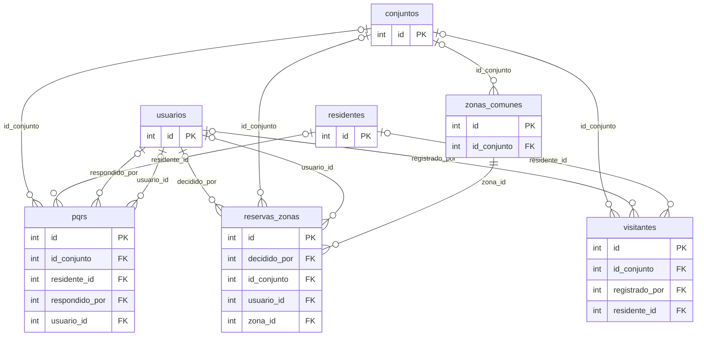

| Tabla.columna | Apunta a | ¿Obligatoria? | Si se borra el registro padre |
|---|---|---|---|
| `pqrs.id_conjunto` | `conjuntos.id` | No | Deja la referencia vacía (`SET NULL`) |
| `pqrs.residente_id` | `residentes.id` | No | Deja la referencia vacía (`SET NULL`) |
| `pqrs.respondido_por` | `usuarios.id` | No | Deja la referencia vacía (`SET NULL`) |
| `pqrs.usuario_id` | `usuarios.id` | No | Deja la referencia vacía (`SET NULL`) |
| `zonas_comunes.id_conjunto` | `conjuntos.id` | No | Borra también el registro (`CASCADE`) |
| `reservas_zonas.decidido_por` | `usuarios.id` | No | Deja la referencia vacía (`SET NULL`) |
| `reservas_zonas.id_conjunto` | `conjuntos.id` | No | Deja la referencia vacía (`SET NULL`) |
| `reservas_zonas.usuario_id` | `usuarios.id` | No | Deja la referencia vacía (`SET NULL`) |
| `reservas_zonas.zona_id` | `zonas_comunes.id` | Sí | Borra también el registro (`CASCADE`) |
| `visitantes.id_conjunto` | `conjuntos.id` | No | Deja la referencia vacía (`SET NULL`) |
| `visitantes.registrado_por` | `usuarios.id` | No | Deja la referencia vacía (`SET NULL`) |
| `visitantes.residente_id` | `residentes.id` | No | Deja la referencia vacía (`SET NULL`) |

### Gobierno del consejo

Votaciones del consejo y aprobación de gastos.

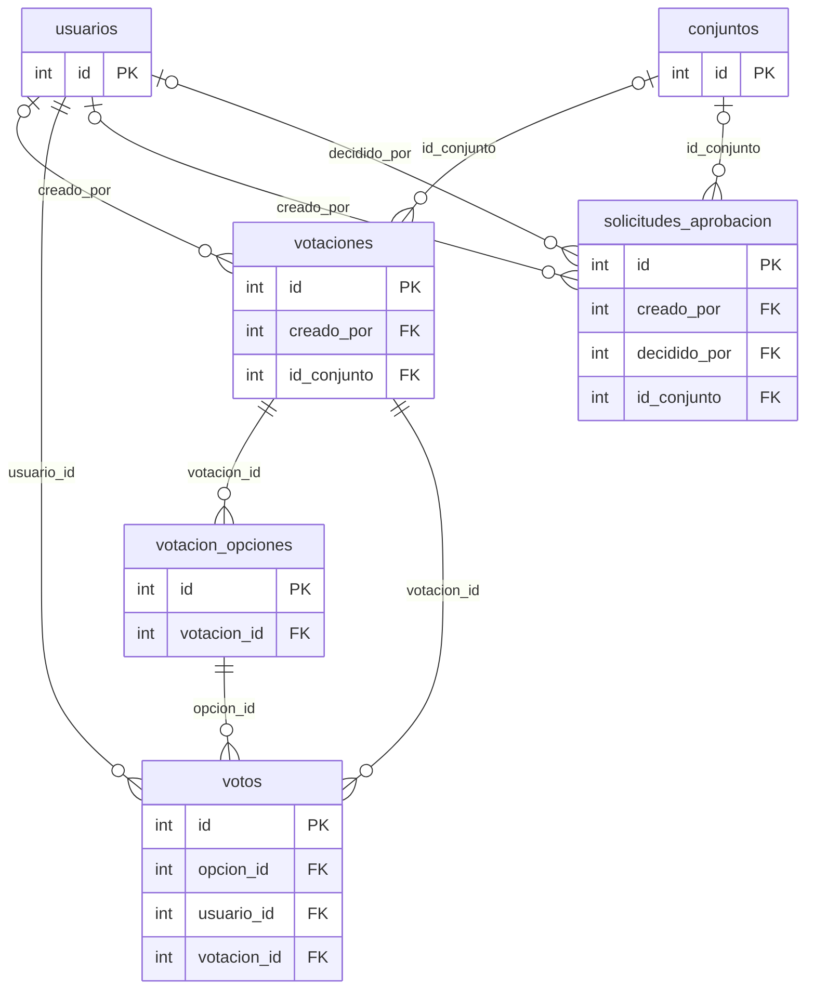

| Tabla.columna | Apunta a | ¿Obligatoria? | Si se borra el registro padre |
|---|---|---|---|
| `votaciones.creado_por` | `usuarios.id` | No | Deja la referencia vacía (`SET NULL`) |
| `votaciones.id_conjunto` | `conjuntos.id` | No | Deja la referencia vacía (`SET NULL`) |
| `votacion_opciones.votacion_id` | `votaciones.id` | Sí | Borra también el registro (`CASCADE`) |
| `votos.opcion_id` | `votacion_opciones.id` | Sí | Borra también el registro (`CASCADE`) |
| `votos.usuario_id` | `usuarios.id` | Sí | Borra también el registro (`CASCADE`) |
| `votos.votacion_id` | `votaciones.id` | Sí | Borra también el registro (`CASCADE`) |
| `solicitudes_aprobacion.creado_por` | `usuarios.id` | No | Deja la referencia vacía (`SET NULL`) |
| `solicitudes_aprobacion.decidido_por` | `usuarios.id` | No | Deja la referencia vacía (`SET NULL`) |
| `solicitudes_aprobacion.id_conjunto` | `conjuntos.id` | No | Deja la referencia vacía (`SET NULL`) |

### Comunicación

Chatbot, mensajería directa residente ↔ administración, avisos y notificaciones push.

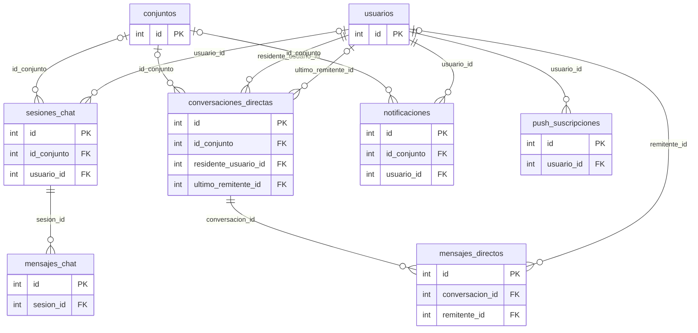

| Tabla.columna | Apunta a | ¿Obligatoria? | Si se borra el registro padre |
|---|---|---|---|
| `sesiones_chat.id_conjunto` | `conjuntos.id` | No | Deja la referencia vacía (`SET NULL`) |
| `sesiones_chat.usuario_id` | `usuarios.id` | No | Deja la referencia vacía (`SET NULL`) |
| `mensajes_chat.sesion_id` | `sesiones_chat.id` | Sí | Borra también el registro (`CASCADE`) |
| `conversaciones_directas.id_conjunto` | `conjuntos.id` | No | Deja la referencia vacía (`SET NULL`) |
| `conversaciones_directas.residente_usuario_id` | `usuarios.id` | Sí | Borra también el registro (`CASCADE`) |
| `conversaciones_directas.ultimo_remitente_id` ★ | `usuarios.id` | No | Deja la referencia vacía (`SET NULL`) |
| `mensajes_directos.conversacion_id` | `conversaciones_directas.id` | Sí | Borra también el registro (`CASCADE`) |
| `mensajes_directos.remitente_id` | `usuarios.id` | No | Deja la referencia vacía (`SET NULL`) |
| `notificaciones.id_conjunto` | `conjuntos.id` | No | Borra también el registro (`CASCADE`) |
| `notificaciones.usuario_id` | `usuarios.id` | Sí | Borra también el registro (`CASCADE`) |
| `push_suscripciones.usuario_id` | `usuarios.id` | Sí | Borra también el registro (`CASCADE`) |

### Configuración

Parámetros del sistema, globales o por conjunto.

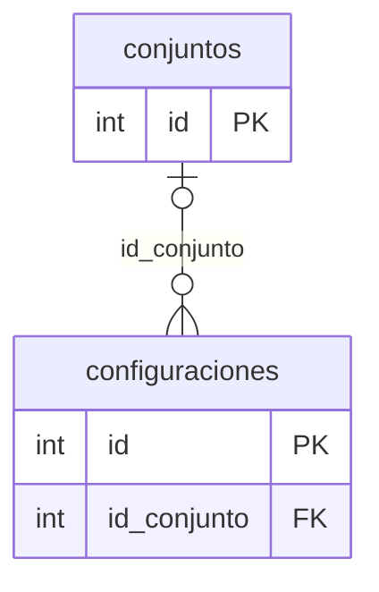

| Tabla.columna | Apunta a | ¿Obligatoria? | Si se borra el registro padre |
|---|---|---|---|
| `configuraciones.id_conjunto` | `conjuntos.id` | No | Borra también el registro (`CASCADE`) |

### Auditoría

Historial de acciones realizadas en la plataforma.

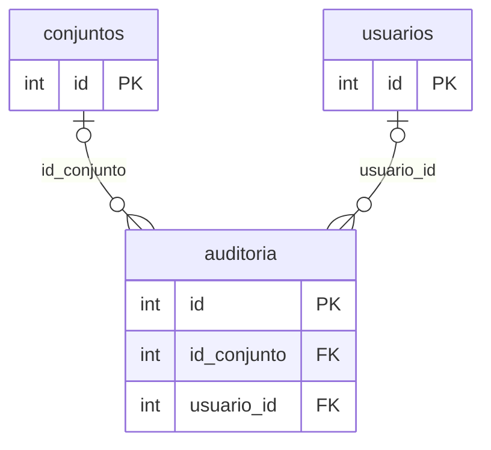

| Tabla.columna | Apunta a | ¿Obligatoria? | Si se borra el registro padre |
|---|---|---|---|
| `auditoria.id_conjunto` | `conjuntos.id` | No | Deja la referencia vacía (`SET NULL`) |
| `auditoria.usuario_id` | `usuarios.id` | No | Deja la referencia vacía (`SET NULL`) |

## Tabla `configuraciones`

| Columna | Descripción |
|---|---|
| `clave` | Nombre del parámetro (ej. `interest_rate_late`) |
| `valor` | Valor en texto |
| `categoria` | `general`, `finanzas`, `seguridad`, `archivos`, `notificaciones`, `chatbot` |
| `tipo` | `texto`, `numero`, `booleano` o `json` |
| `id_conjunto` | `NULL` = global; con valor = sobreescribe el global solo para ese conjunto |
| `editable` | `false` = informativo, no se modifica desde el panel |

La clave es única por ámbito (una global y una por conjunto). Consulta con herencia:

```sql
SELECT fn_config('interest_rate_late', 3);   -- valor del conjunto 3, o el global si no tiene
```

API: `GET /configuracion?categoria=finanzas` y `PUT /configuracion` (acepta `id_conjunto`).

## Integridad

- **65 llaves foráneas, todas con índice** en la columna que referencian (acelera los JOIN y los borrados en cascada).
- **Comportamiento al borrar** definido en cada FK: 45 usan `SET NULL` (el dato histórico se conserva), 18 usan `CASCADE` (el registro hijo no tiene sentido sin su padre, p. ej. opciones de una votación) y 2 usan `NO ACTION` a propósito: no se puede borrar un `rol` (`usuarios.rol_id`) ni un `concepto financiero` (`movimientos_financieros.concepto_id`) que esté en uso.
- **21 restricciones `CHECK`** con los estados válidos de cada módulo (se omiten con aviso si una base antigua tiene datos que no las cumplen).
- Las FK complementarias (sección 11B de `init.sql`) se crean con `NOT VALID` si una base antigua tiene valores huérfanos: protegen los datos nuevos sin modificar los existentes.
- Triggers: `trg_configuraciones` y `trg_pqrs_actualizacion` mantienen las fechas de actualización.

## Cambios de esta revisión

| Cambio | Detalle |
|---|---|
| ★ `usuarios.id_copropiedad` → `conjuntos.id` | Campo heredado que guardaba un id de conjunto sin estar conectado. |
| ★ `conversaciones_directas.ultimo_remitente_id` → `usuarios.id` | Quién escribió el último mensaje de la conversación. |
| 19 índices nuevos | Cubren las FK que no tenían índice (`pqrs.residente_id`, `visitantes.residente_id`, `documentos.propiedad_id`, `votos.opcion_id`, ...). |
| Diagrama completo | El anterior mostraba 21 de las 63 relaciones que ya existían. |
